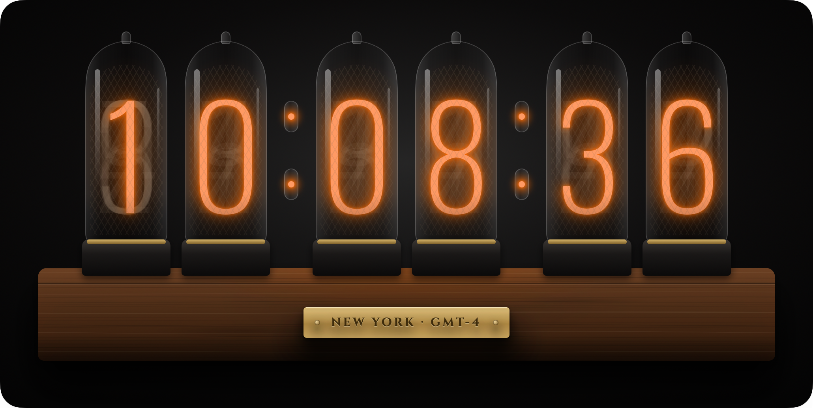
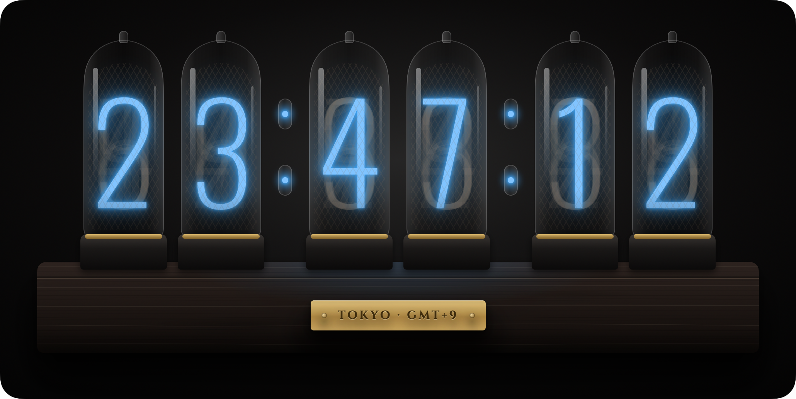
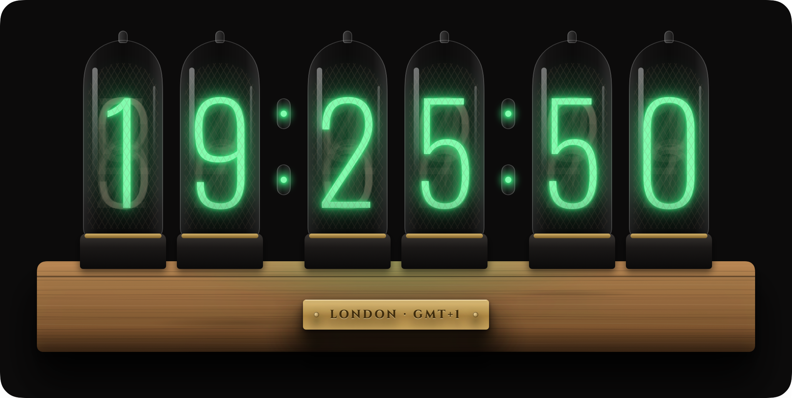
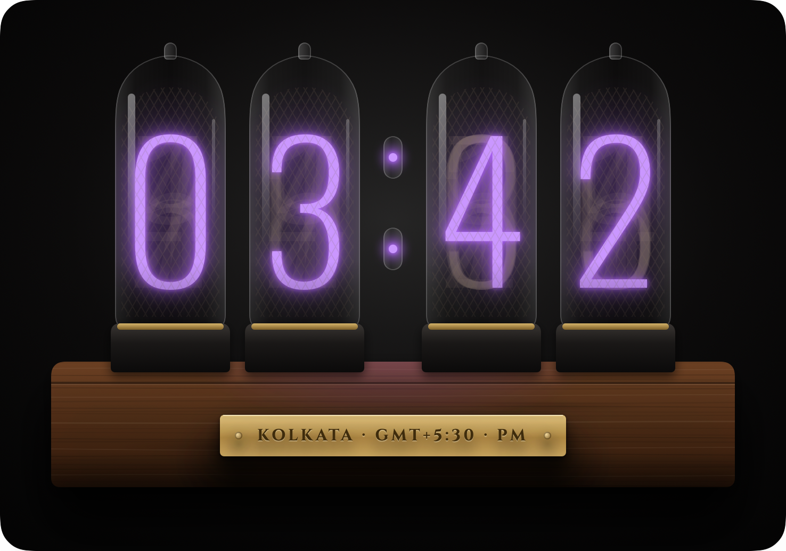
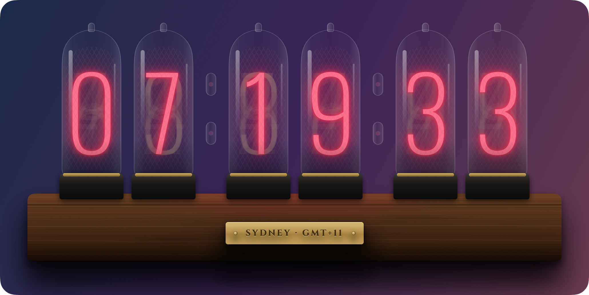

# Nixie Clock

A glowing Nixie tube clock that lives on your Mac desktop.

  

Glass tubes, softly glowing digits, a wooden base and a brass nameplate, drawn natively in SwiftUI
and sharp at any size. Run one clock or a whole row of them, each in its own time zone.

## Features

**Looks like the real thing**
- Layered glass tubes with domed envelopes, reflections, a fine anode mesh, and the faint
  unlit cathodes showing behind the lit digit
- Neon separator lamps that blink once a second
- A wooden base in **Walnut**, **Oak** or **Ebony**, with the glow reflected on top
- A brass nameplate showing the city, GMT offset, and AM/PM in 12‑hour mode
- An hourly *cathode cycle*: at the top of each hour every tube ripples through all ten digits,
  the way real Nixie clocks keep their cathodes from wearing out

**Make it yours**
- Any glow color: six presets (Nixie Orange, Neon Red, Ice Blue, Phosphor Green, Violet,
  Warm White) or a custom color
- Any background color and opacity, styled as **Vignette**, **Solid** or **Transparent** to float
  the clock right on your wallpaper
- 24‑hour or 12‑hour time, with or without seconds
- Separator blinking, the nameplate, digit crossfades and the hourly cycle can each be turned off

**Lives on your desktop**
- Sits just above your desktop icons and appears on every Space, so app windows cover it. It can
  also float above other windows instead.
- Drag to move it. Drag any edge or corner to resize it, and it keeps its proportions.
- **Lock position** makes the clock click‑through, so it behaves like part of the wallpaper
- Lives in the menu bar with no Dock icon. All settings are in the menu bar panel.
- **Multiple clocks**, each with its own time zone, colors and settings. Search time zones by
  city, zone ID or name.
- Remembers every clock's settings, position and size, and can launch at login
- Light on resources: about 1.5% CPU with digit animation on, under 1% with it off

## Gallery

<table>
  <tr>
    <td></td>
    <td></td>
  </tr>
  <tr>
    <td align="center">Ice Blue · Ebony · Tokyo</td>
    <td align="center">Phosphor Green · Oak · Solid background · London</td>
  </tr>
  <tr>
    <td></td>
    <td></td>
  </tr>
  <tr>
    <td align="center">Violet · 12‑hour, no seconds · Kolkata</td>
    <td align="center">Neon Red · Transparent background · Sydney</td>
  </tr>
</table>

## Requirements

macOS 14 Sonoma or later.

## Install

Download `NixieClock.dmg` from the [Releases](../../releases) page, open it, and drag
**NixieClock** into **Applications**. Launch it and look for the clock in your menu bar.

## Build from source

1. Open `NixieClock.xcodeproj` in Xcode.
2. Under **Signing & Capabilities**, choose your team. A free Apple ID (Personal Team) is enough to
   run it on your own Mac.
3. Press **Run**.

The app has no third‑party dependencies. [PLAN.md](PLAN.md) covers the design and architecture in
detail.

To regenerate the screenshots in this README, follow the instructions at the top of
[`Tools/render_readme_images.swift`](Tools/render_readme_images.swift). It renders them from the
app's own views.

## Credits

The tube numerals use [Oswald](https://fonts.google.com/specimen/Oswald) and the nameplate uses
[Cinzel](https://fonts.google.com/specimen/Cinzel). Both are licensed under the SIL Open Font
License 1.1, and their license files are in `NixieClock/Resources/Fonts`.
